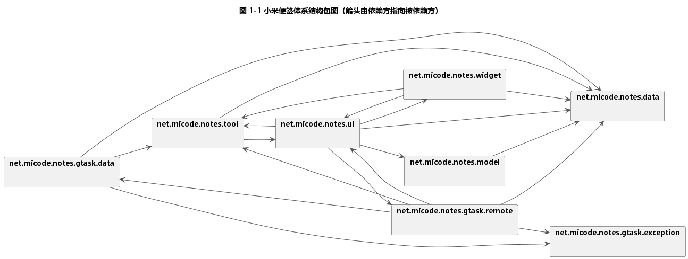
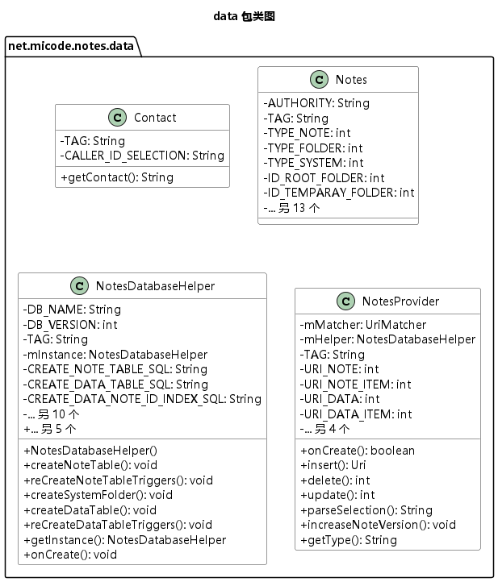
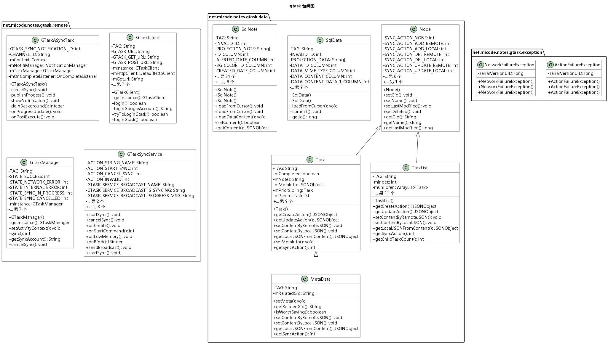
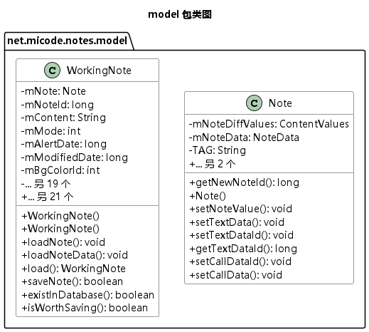
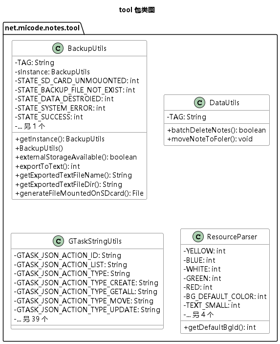
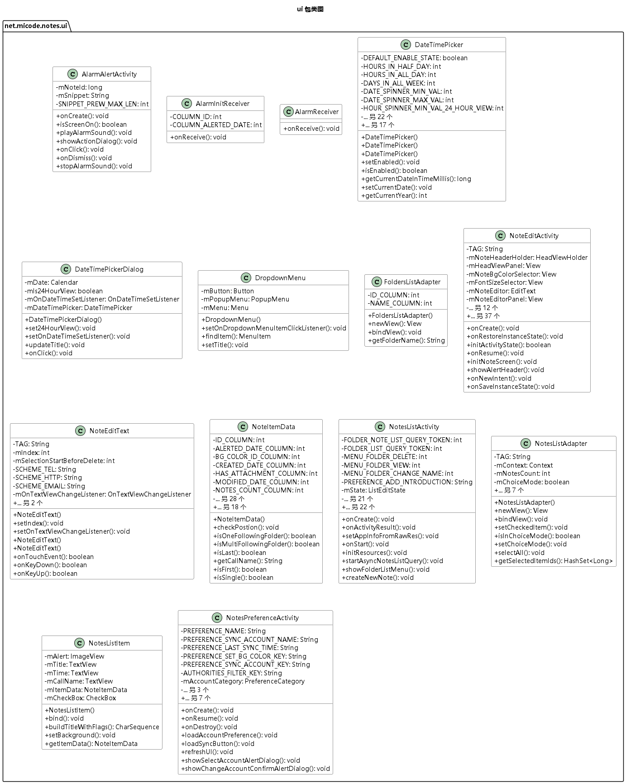
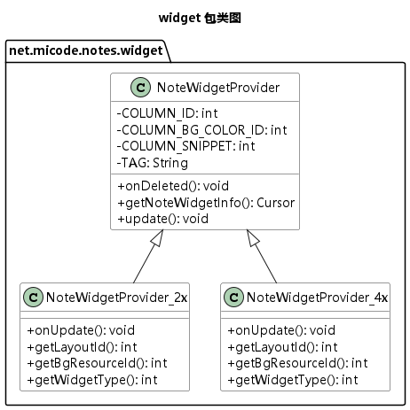

# 第 1 章 泛读开源代码

## 1.1 软件概况

小米便签（MiCode Notes）是小米开源社区 2010 至 2011 年开源的 Android 原生便签应用，作者为 MiCode Open Source Community，Apache License 2.0 协议。应用版本 0.1，包名 net.micode.notes，构建目标为 SDK 35、最低支持 14。工程沿用原来的布局，`src/` 与 `res/` 直接放在根目录，没有改成 `app/src/main` 的标准结构。本次以课程提供的原始源码为基线，另建工作目录补齐 Gradle 配置后开展维护。

表 1-1 代码规模

| 统计项 | 维护前 | 维护后 | 变化 |
| --- | --- | --- | --- |
| Java 文件数 | 39 | 39 | 0 |
| 总行数 | 10001 | 10386 | +385 |
| 空行 | 1401 | 1424 | +23 |
| 纯注释行 | 1206 | 1286 | +80 |
| 含代码的行 | 7394 | 7676 | +282 |
| 顶层类 / 接口 | 39 | 39 | 0 |
| 命名内部类 | 26 | 26 | 0 |
| 顶层方法 | 372 | 384 | +12 |
| 包数 | 8 | 8 | 0 |

维护后各包的分布见表 1-2。

表 1-2 各包代码规模

| 包 | 文件 | 行数 | 类 | 方法 |
| --- | --- | --- | --- | --- |
| data | 4 | 1079 | 4 | 21 |
| gtask.data | 6 | 1571 | 6 | 74 |
| gtask.exception | 2 | 66 | 2 | 6 |
| gtask.remote | 4 | 1661 | 4 | 30 |
| model | 2 | 621 | 2 | 39 |
| tool | 4 | 946 | 4 | 10 |
| ui | 14 | 4217 | 14 | 193 |
| widget | 3 | 225 | 3 | 11 |

统计口径：总行数取 `find src -name "*.java" | xargs wc -l`；空行按"去空白后为空"判断，去掉空行后以 `//`、`*`、`/*` 开头的行为纯注释行，两者相减得到含代码的行，三类相加等于总行数；顶层类型与方法只算四空格缩进的那一层，命名内部类单独计数，匿名类不计。同样数字可用 `python tools/gen_uml.py src <输出目录>` 重跑，指向原始基线目录即得维护前的值。

## 1.2 体系结构

应用分成四层。最上面是 `ui` 和 `widget`，负责界面和桌面小部件；中间是 `model` 与 `tool`，前者维护单条便签的编辑状态，后者是不持有状态的工具方法；再往下是 `data`，包含数据库契约、建表和触发器、对外的 ContentProvider；`gtask` 单独一支，做 Google Tasks 同步，其中 `remote` 管网络，`data` 管本地表与服务端 JSON 的互转。

图 1-1 是按 import 关系生成的包图，箭头从依赖方指向被依赖方。

`ui` 依赖 data、gtask.remote、model、tool、widget 五个包，是唯一的扇出中心；`data` 被其余各包依赖，自己却不依赖任何业务包。这两个特征是界面层聚合下层、数据层保持独立的结果，和上面描述的分层是一致的。

另有一处不对劲的地方：`tool` 和 `ui` 之间是双向箭头。`DataUtils` 为了读桌面小部件的属性，直接 import 了 `ui.NotesListAdapter.AppWidgetAttribute`（`DataUtils.java:32`）。工具层本应最底层，现在反过来依赖了表现层，第 2 章会展开说。

## 1.3 功能与类的对应关系

表 1-3 功能与类的映射

| 功能 | 主要类 | 说明 |
| --- | --- | --- |
| 列表浏览 | `NotesListActivity`、`NotesListAdapter`、`NotesListItem`、`NoteItemData` | `NoteItemData` 解析 Cursor，`NotesListItem` 绑定视图 |
| 便签编辑 | `NoteEditActivity`、`NoteEditText`、`WorkingNote`、`Note` | 编辑态存在 `WorkingNote` 里，`saveNote()` 统一落库 |
| 文件夹管理 | `NotesListActivity`、`FoldersListAdapter`、`DropdownMenu` | 文件夹就是 `TYPE_FOLDER` 的一行 note，计数由触发器维护 |
| 数据持久化 | `NotesProvider`、`NotesDatabaseHelper`、`Notes`、`DataUtils` | Provider 暴露 URI，Helper 建表建触发器 |
| 提醒闹钟 | `AlarmReceiver`、`AlarmAlertActivity`、`AlarmInitReceiver` | 开机重建闹钟，到点弹提醒 |
| 桌面小部件 | `NoteWidgetProvider`、`NoteWidgetProvider_2x`、`NoteWidgetProvider_4x` | 2x 与 4x 继承同一个基类 |
| 任务同步 | `GTaskManager`、`GTaskClient`、`GTaskASyncTask`、`GTaskSyncService`、`Task`、`TaskList`、`SqlNote`、`SqlData` | remote 走网络，data 负责结构转换 |
| 备份 | `BackupUtils` | 导出与导入便签文本 |
| 设置 | `NotesPreferenceActivity`、`ResourceParser` | 偏好项文案从 xml 解析 |
| 便签锁定（新增） | `NoteEditActivity`、`Notes`、`NotesDatabaseHelper`、`NoteItemData`、`NotesListItem` | 新增 `is_locked` 列，加锁后正文只读 |
| 标签与筛选（新增） | `NoteEditActivity`、`NotesListActivity`、`NotesDatabaseHelper` | 新增 `tags` 列，列表按标签 LIKE 匹配 |
| 列表排序（新增） | `NotesListActivity` | 修改时间、创建时间各两种方向 |

## 1.4 六个核心包

**data** 负责数据落地。`Notes` 只放表名列名这类常量，`NotesDatabaseHelper` 管建表和 v1 到 v5 的逐版本升级，`NotesProvider` 把 URI 翻译成具体 SQL。

**gtask** 负责同步。`GTaskClient` 封装 HTTP 和 JSON，`GTaskManager` 调度流程，`GTaskASyncTask` 是后台任务，`gtask.data` 里的 `Task`、`TaskList`、`Node` 是服务端的树形模型，`SqlNote` 与 `SqlData` 负责和本地表互转。

**model** 只有两个类。`WorkingNote` 是核心，它同时持有 note 和 data 两类记录，提供 `setWorkingText`、`saveNote`，让 Activity 不必直接拼 ContentValues；`Note` 只是数据载体。

**tool** 是工具集。`DataUtils` 提供批量删除、批量移动这类组合操作，`BackupUtils` 管备份文件读写，`ResourceParser` 解析偏好文案，`GTaskStringUtils` 放同步用的 JSON 键名。

**ui** 是全部界面。`NotesListActivity` 管列表、文件夹、排序与筛选，`NoteEditActivity` 管编辑、提醒、锁定与标签，`DateTimePicker` 是自绘的日期时间选择器，`AlarmAlertActivity` 是提醒弹窗，`NotesPreferenceActivity` 是设置页。

**widget** 只有三个类。`NoteWidgetProvider` 是抽象基类，`_2x` 和 `_4x` 只覆写尺寸相关的配置。

