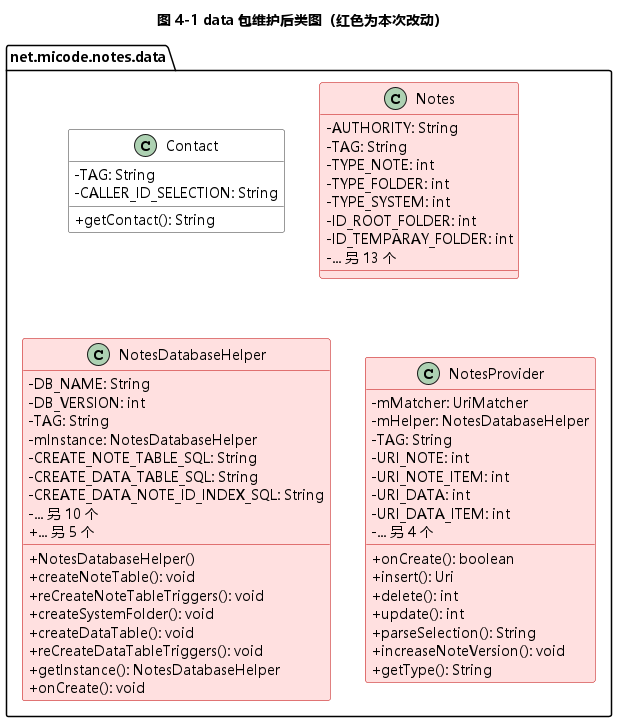
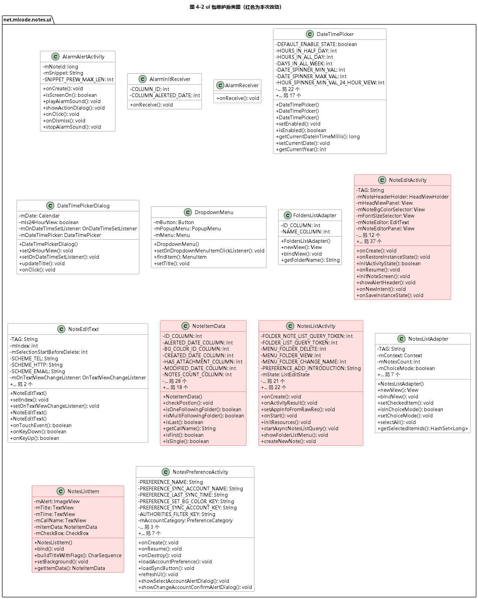

# 第 4 章 维护开源软件

## 4.1 四类维护的区别

四类维护的界线在于"为什么要改"，而不是"改了多少"。

纠正性维护是软件没按规格工作，必须改，改完功能不变。改善性维护是用户提出原软件没有的能力，改完功能变多。适应性维护是运行环境变了，不改就跑不起来或者跑不稳，功能本身不变。预防性维护没人报问题，是提前把以后可能出事的结构改掉，功能通常也不变。

本次做了纠正性两处、改善性三个功能、适应性两处。预防性没有单独立项，但纠正性维护里顺带做了一点：版本递增改成参数绑定后，同一段代码顺带消除了注入风险，属于改缺陷的同时把同类隐患一起处理了。

## 4.2 纠正性维护

### 缺陷一：不传条件时批量删除一条也删不掉

`NotesProvider.delete()` 里原来无条件拼条件：

```java
// 维护前 NotesProvider.java:192
case URI_NOTE:
    selection = "(" + selection + ") AND " + NoteColumns.ID + ">0 ";
    count = db.delete(TABLE.NOTE, selection, selectionArgs);
```

调用方传 `null` 时，`"(" + null + ")"` 会得到字面量 `(null)`。SQLite 不把 `null` 当"没有条件"，而是当一个未知标识符，条件变成 `(null) AND _id>0`，恒不成立。

影响面要说清楚：这是 `CONTENT_NOTE_URI` 对外语义的缺陷，不是界面上能看见的故障——翻了整个工程的调用点，当前没有任何地方以空条件调用这个 URI，所以用户实际碰不到。但接口是对外开放的，别人按文档传 `null` 就会踩到，属于契约错误，仍然要修。

改法是只有真传了条件才拼：

```java
String noteSelection;
if (TextUtils.isEmpty(selection)) {
    noteSelection = NoteColumns.ID + ">0";
} else {
    noteSelection = "(" + selection + ") AND " + NoteColumns.ID + ">0";
}
```

验证方式是构造 `delete(CONTENT_NOTE_URI, null, null)`，断言影响行数等于实际便签数；再传带 id 的条件，断言系统目录没被删。

### 缺陷二：版本递增把参数当成了 SQL 文本

```java
// 维护前 NotesProvider.java:293
if (!TextUtils.isEmpty(selection)) {
    String selectString = id > 0 ? parseSelection(selection) : selection;
    for (String args : selectionArgs) {                        // 为 null 时直接 NPE
        selectString = selectString.replaceFirst("\\?", args);  // 参数被当成替换串
    }
    sql.append(selectString);
}
mHelper.getWritableDatabase().execSQL(sql.toString());         // 没有绑定参数
```

两个毛病叠在一起。一是 `execSQL` 只收最终字符串，参数已经是 SQL 的一部分，值里带个单引号就能闭合；二是 `replaceFirst` 的第二个参数是替换串，里面的 `$` 和 `\` 会被特殊解释，合法内容也会被改写。

改成占位符加绑定：

```java
if (id > 0) {
    where.append(NoteColumns.ID).append("=?");
    whereArgs.add(String.valueOf(id));
}
if (!TextUtils.isEmpty(selection)) {
    if (where.length() > 0) where.append(" AND ");
    where.append("(").append(selection).append(")");
    if (selectionArgs != null) Collections.addAll(whereArgs, selectionArgs);
}
...
mHelper.getWritableDatabase().execSQL(sql.toString(), whereArgs.toArray());
```

验证：条件是 `_id=?`、参数传 `"1 OR 1=1"`，断言只有 id=1 的那行版本加了 1；`selectionArgs` 传 `null`，断言不抛异常。

## 4.3 改善性维护

原版编辑页菜单是 Add note、Delete、Font size、Enter check list、Share、Send to home、Remind me（设了提醒才会多出 Delete remind），列表菜单是 New Folder、Export text、Sync、Settings、Search。没有锁定，也没有标签和排序，三个功能确实是原软件没有的。

### 功能一：便签锁定

需求是有些便签（比如账号、账目）放在列表里可以看见，但打开后不能被误改；要能加锁、解锁，状态要留住，加锁后正文不能输入，列表里能看出哪条锁了。

影响到的文件分三层：数据层 `Notes` 加列常量、`NotesDatabaseHelper` 升到 v5；界面层 `NoteEditActivity` 加菜单和只读控制，`NoteItemData` 读列，`NotesListItem` 显示标记；资源层加菜单项和三套文案。

设计上，列定义成 `INTEGER NOT NULL DEFAULT 0`，升级用 `ALTER TABLE ADD COLUMN`，旧便签自动取 0，不重建表也不丢数据。状态放数据库而不是 `SharedPreferences`，因为锁定是便签自己的属性，要跟随便签一起被备份和同步。菜单标题随状态切换成 `Lock note` / `Unlock note`，减少误点。

```java
// NoteEditActivity.java:929
private void toggleNoteLock() {
    if (mWorkingNote == null || !mWorkingNote.existInDatabase()) {
        showToast(R.string.toast_note_unsaved);
        return;
    }
    mNoteLocked = !mNoteLocked;
    ContentValues values = new ContentValues();
    values.put(NoteColumns.IS_LOCKED, mNoteLocked ? 1 : 0);
    getContentResolver().update(
            ContentUris.withAppendedId(Notes.CONTENT_NOTE_URI, mWorkingNote.getNoteId()),
            values, null, null);
    applyLockState();
    showToast(mNoteLocked ? R.string.toast_note_locked : R.string.toast_note_unlocked);
}
```

只读是用 `applyLockState()` 关掉光标和长按实现的，没有把 `EditText` 设成 `disabled`——那样软键盘弹不出来，滚动位置也会丢。

### 功能二：便签标签与筛选

需求是给一条便签打几个关键词（如 work、账单），列表里能看见，也能按关键词过滤。

标签存成一列 `TEXT`，没有另建关联表。理由是这个场景标签少、只做包含匹配，多一张表就得多一套级联删除逻辑，不划算；代价是做不了标签云和去重统计，这一点记在 4.8。保存前统一过一遍 `normalizeTags()`：按逗号、顿号或空白切开，用 `LinkedHashSet` 去重并保持顺序，单个标签超过 8 个字截断，最多留 3 个，最后用逗号连成一个字符串存库，全空就当清除。这样 `"work, 账单"` 和 `"work 账单"` 会得到同一个结果，列表里显示成 `[work,bill]` 这种形式。

筛选这一句是关键：

```java
// NotesListActivity.java:431
selection = "(" + selection + ") AND " + NoteColumns.TAGS + " LIKE ?";
// 标签值走参数绑定，不拼进 SQL
```

### 功能三：列表排序

需求是原来只能按修改时间倒序，要能按创建时间看，也要正序。

只改了 `NotesListActivity` 一个类。`ORDER BY` 的第一段固定 `TYPE DESC`，保证文件夹永远在便签前面；第二段才是用户选的字段。四种组合事先拼成字符串数组，切换时改 `mOrderBy` 再重查，不重建 Adapter。

```java
// NotesListActivity.java:858
final String[] orders = new String[] {
        NoteColumns.TYPE + " DESC," + NoteColumns.MODIFIED_DATE + " DESC",
        NoteColumns.TYPE + " DESC," + NoteColumns.MODIFIED_DATE + " ASC",
        NoteColumns.TYPE + " DESC," + NoteColumns.CREATED_DATE + " DESC",
        NoteColumns.TYPE + " DESC," + NoteColumns.CREATED_DATE + " ASC"
};
```

三个功能的验收用例分别是 T1～T3、T4～T6、T7～T8，执行情况见 4.7。

## 4.4 适应性维护

原工程在新环境下编不过，卡在 `Notification.setLatestEventInfo`——这个方法在新 SDK 里删了。换成 `Notification.Builder`，并在 Android 8.0 以上建通知渠道；`compileOptions` 从 Java 8 提到 11，消掉过时警告；清单里去掉 `package`、`versionCode`、`versionName`、`uses-sdk`，改由 `build.gradle` 的 `namespace` 和 `defaultConfig` 提供。

这一项留了个尾巴：`Notification.Builder#build()` 要 API 16，工程 `minSdk` 还是 14，Lint 报 `NewApi`（`GTaskASyncTask.java:107`）。低版本设备走到这个分支会崩。下轮改成 `NotificationCompat.Builder` 或者加版本判断即可。这条在第 2 章表 2-2 第 1 条也记了，没藏。

## 4.5 新增与修改一览

表 4-1 新增或修改的功能一览

| 编号 | 功能 / 改动 | 类型 | 涉及文件 | 关键实现 |
| --- | --- | --- | --- | --- |
| F1 | 便签锁定 | 改善性 | `Notes`、`NotesDatabaseHelper`、`NoteEditActivity`、`NoteItemData`、`NotesListItem` | `is_locked` 列加 `toggleNoteLock()` 与只读态 |
| F2 | 便签标签 | 改善性 | `Notes`、`NotesDatabaseHelper`、`NoteEditActivity`、`NoteItemData`、`NotesListItem` | `tags` 列加设置对话框与归一化 |
| F3 | 按标签筛选 | 改善性 | `NotesListActivity` | `TAGS LIKE ?` 参数绑定 |
| F4 | 列表排序 | 改善性 | `NotesListActivity`、`res/menu/note_list.xml` | 四种 `ORDER BY` 加重查 |
| D1 | 空条件批量删除失效 | 纠正性 | `NotesProvider` | 条件为空时不拼接 |
| D2 | 版本递增把参数当 SQL | 纠正性 | `NotesProvider` | `?` 占位加 `whereArgs` 绑定 |
| A1 | 通知接口替换 | 适应性 | `GTaskASyncTask` | `Notification.Builder` 加通知渠道 |
| A2 | 构建与清单适配 | 适应性 | `build.gradle`、`AndroidManifest.xml` | `namespace`、Java 11、去掉清单旧字段 |

代码总量从 10001 行到 10386 行，方法从 372 个到 384 个。文件数仍是 39：三个功能都加在既有的列表、编辑、数据三类里，没有新建类。这样做的好处是不用改 `AndroidManifest.xml`、不用新增资源引用，改动面小；代价是 `NoteEditActivity` 从 873 行涨到 1015 行，这个类本来就不小。分包的规模见第 1 章表 1-2。

## 4.6 维护后类图

红色是本次动过的类。data 包里四个类动了三个，`Contact` 没碰；ui 包里动的是列表和编辑两条主线上的类。

图 4-1 data 包维护后类图



图 4-2 ui 包维护后类图



## 4.7 软件测试

表 4-2 测试用例与执行情况

| 编号 | 用例 | 步骤 | 预期 | 实际结果 |
| --- | --- | --- | --- | --- |
| T1 | 加锁 | 打开便签，菜单点 `Lock note` | 加锁成功，列表出现 `[Locked]` | 通过，列表显示 `[Locked] old-two` |
| T2 | 锁定状态留住 | T1 后 `am force-stop` 再打开 | 该条仍是 `[Locked]` | 通过，重开后标记还在 |
| T3 | 锁定后只读 | 点正文，再 `adb input text ZZZ` | 键盘不弹，文本不变 | 通过，`mInputShown=false`，正文仍是 `alpha-note` |
| T4 | 设置标签 | 菜单 `Tags`，输 `work` | 列表显示 `[work]` | 通过 |
| T5 | 标签归一化 | 输 `work,, work , bill` | 去重、截断、逗号连接后存库 | 通过，库中 `tags='work,bill'`，重复的 work 被去掉 |
| T6 | 按标签筛选 | 菜单 `Filter by tag` → `work` | 只剩带该标签的便签 | 通过，4 条筛选后剩 1 条 |
| T7 | 排序切换 | 菜单 `Sort` → Created time, oldest first | 顺序反转，文件夹仍在便签前 | 通过，顺序由 charlie→bravo→alpha→Welcome 变为反向 |
| T8 | 排序不丢数据 | T7 后强杀重开 | 条数不变、无重复 | 通过，重启前后都是 4 条；排序回到默认 |
| T9 | 升级保数据 | v4 库建 7 条 → 不卸载，覆盖安装新版 | 便签全在，新列取默认值 | 通过，`user_version` 4→5，7 条全在，`is_locked=0`、`tags=''` |
| T10 | 空条件删除 | `adb shell content delete --uri content://micode_notes/note` | 便签被删，系统目录保留 | 未执行。Provider 未声明 `android:exported`，adb 被 `SecurityException` 拒绝 |

执行环境：AVD `Medium_Phone_API_37.0`，包名 `net.micode.notes`。九条通过的用例都在模拟器上实际操作过，截图存在 `docs/shots/`（`T2-list-locked.png`、`T3-locked-editor.png`、`T6-filter-work.png`、`T7-sort-asc.png`、`baseline-01-list-v4.png`）。

T9 是这样做的：先把基线源码拷到独立目录，只补通知接口那处适配，编出一个 APK 装上，建 7 条便签，确认库版本为 4、表里没有 `is_locked` 和 `tags` 列；然后不卸载，直接覆盖安装新版；升级后库版本变 5，两列出现，7 条便签的内容和 id 都没变，新列取默认值。新版本能跑说明不了升级是否丢数据，只有这一趟能说明。

T10 走不通的原因也确认了：清单里 `<provider>` 没写 `android:exported`，`targetSdk` 28 起默认不导出，所以 `adb shell content` 直接抛 `SecurityException: ... not exported from UID`。应用内也没有任意位置以空条件调用 `CONTENT_NOTE_URI`，界面上构造不出来。要覆盖它只能写 instrumented test，本轮没做，记为未执行而不是通过。

## 4.8 遗留与限制

1. 排序方式只在内存里，重启回到"修改时间倒序"。要留住得写 `SharedPreferences`，在 `onCreate` 读回来。
2. 标签是一列文本，做不了去重统计，也撑不起标签云；要扩展得改成标签表加关联表。
3. 锁定只挡界面误操作，不加密。数据库没加密，root 过的设备照样能读。
4. 批量操作没有事务（见第 2 章不足二），中途失败会留下部分已修改的数据，需要在 Provider 里重写 `applyBatch` 补上。
5. 通知的 `NewApi` 问题（4.4）还没修。
6. T10 未执行：`<provider>` 没有声明 `android:exported`，`targetSdk` 28 起默认不导出，adb 调用被 `SecurityException` 拒绝；应用内也没有任何地方以空条件调用 `CONTENT_NOTE_URI`。要覆盖它只能写 instrumented test，本轮不做，报告里如实记为未执行。
